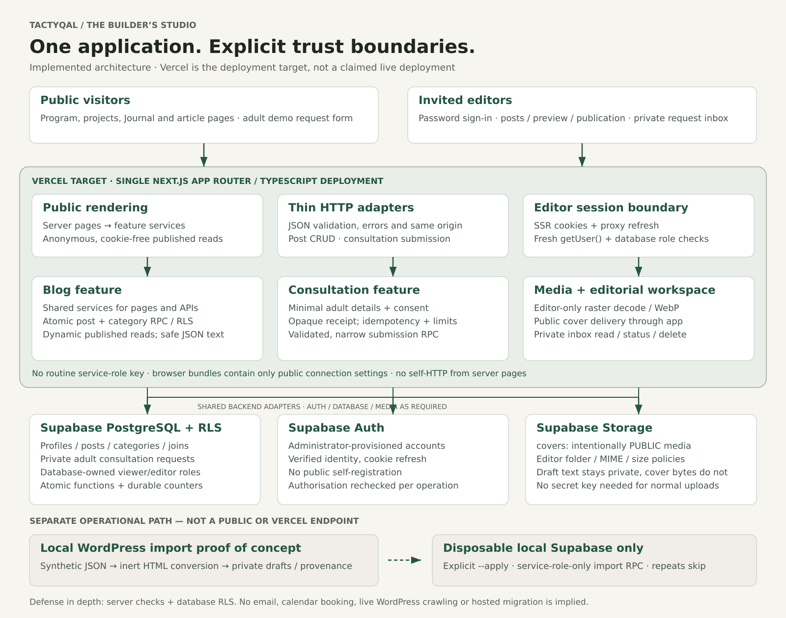

# Tactyqal Labs — Homepage Redesign + Blog Platform

Submission for the **Tactyqal Labs Full Stack Developer Intern hiring challenge**. A parent-facing homepage redesign backed by a real database-driven blog, a protected editor workspace, and a consultation-request pipeline.

**Live URL:** [tactyqal.vercel.app](https://tactyqal.vercel.app/)

## Demo / Editor Login

Use this account to sign in to the editor workspace at `/admin`:

- **Email:** `test123@gmail.com`
- **Password:** `Test147852#`

## What's Included

- **Public website** — parent-first homepage (hero → student apps → program → testimonials → Journal → pricing → FAQ → contact), real student-apps gallery, database-backed blog with search/categories/pagination, consultation form.
- **Editor workspace** (`/admin`) — password-protected CRUD for posts (draft/publish/unpublish/delete), cover image upload, categories, and a consultation-request inbox.
- **Backend** — PostgreSQL (Supabase) schema with RLS, validated REST API, rate-limited consultation endpoint, image validation/re-encoding on upload.
- **WordPress migration script** — idempotent importer that pulls all published posts from `tactyqal.com/blog` into the database (`pnpm import:wp`), preserving slugs, dates, categories, and images.

## Architecture



- **Framework:** Next.js 16 (App Router), React 19, TypeScript
- **Styling:** Tailwind CSS 4, Radix-based UI primitives
- **Data:** Supabase (PostgreSQL, Auth, Storage)
- **Validation/media:** Zod, Sharp
- **Testing:** Vitest, Testing Library, Playwright, pgTAP

```text
src/
├── app/            Public/auth/admin routes and API routes
├── features/       Blog, auth, consultations, marketing, projects, media
├── components/     Shared UI primitives and layout
├── content/        Typed program/pricing/FAQ/testimonial content
└── lib/            Supabase clients, HTTP contracts, env validation
supabase/
├── migrations/     Schema, RLS policies, functions, indexes
└── tests/          Database permission/integrity tests
scripts/            Local setup and WordPress import
docs/               Architecture, design, and deployment docs
```

See [docs/architecture/repository-structure.md](docs/architecture/repository-structure.md) for details.

## Run Locally

**Requirements:** Node 22–24, pnpm 10.34.9, Docker, Supabase CLI 3.0.0

```bash
pnpm install --frozen-lockfile
pnpm db:start      # starts local Supabase, applies migrations + seed
pnpm env:local      # creates .env.local with local connection values
pnpm editor:local   # provisions a disposable local editor account
pnpm dev
```

Open `http://localhost:3000`. If HMR is unreliable, use `pnpm build && pnpm start` instead.

### Environment variables

| Variable | Required | Purpose |
|---|---|---|
| `NEXT_PUBLIC_SUPABASE_URL` | Yes | Supabase project URL |
| `NEXT_PUBLIC_SUPABASE_PUBLISHABLE_KEY` | Yes | Browser-safe Supabase key |
| `NEXT_PUBLIC_SITE_URL` | Yes | Canonical public origin |
| `SUPABASE_SERVICE_ROLE_KEY` | Only for `import:wp` | Bypasses RLS for the WordPress migration script |

## Deploy to Vercel

See the [full deployment runbook](docs/deployment/vercel.md). Summary: create a hosted Supabase project, apply migrations, create the public `covers` storage bucket, disable public signup, import the repo into Vercel (Next.js, Node 24, `pnpm install --frozen-lockfile`, `pnpm build`), and set the environment variables above.

> Hosted uploads are capped by Vercel's 4.5 MB function payload limit — use cover images under 2 MB in the hosted demo.

## API

All responses share one envelope: `{ data }` on success, `{ error: { code, message, fields? } }` on failure. Full endpoint list with curl examples is rendered live at **`/docs`**.

| Method | Path | Auth | Description |
|---|---|---|---|
| GET | `/api/posts` | Public | List published posts (pagination, search, category) |
| GET | `/api/posts/:slug` | Public | Get a published post by slug |
| GET | `/api/categories` | Public | List categories |
| POST | `/api/consultations` | Public | Submit a consultation request |
| GET/POST | `/api/admin/posts` | Editor | List / create posts |
| PATCH/DELETE | `/api/admin/posts/:id` | Editor | Update / delete a post |
| GET | `/api/admin/inquiries` | Editor | List consultation requests |
| PATCH | `/api/admin/inquiries/:id` | Editor | Update status / delete a request |
| POST | `/api/admin/uploads` | Editor | Upload and validate a cover image |
| GET | `/api/health` | Public | Health check |

## Verification

| Command | Result |
|---|---|
| `pnpm check` | Lint, strict TypeScript, 17 unit/component tests pass |
| `pnpm db:test` | 131 database permission/integrity assertions pass |
| `pnpm test:import` | 4 importer tests pass |
| `pnpm test:integration` | Persisted HTTP CRUD tests pass |
| `pnpm test:e2e` | 20 browser tests pass |
| `pnpm build` | Production build passes |

## Further Documentation

- [Product brief and user journeys](docs/product/product-brief.md)
- [Design specification](docs/design/design-specification.md)
- [Repository architecture](docs/architecture/repository-structure.md)
- [Database and role provisioning](docs/architecture/database.md)
- [Blog API contract](docs/architecture/blog-api.md)
- [Deployment runbook](docs/deployment/vercel.md)
