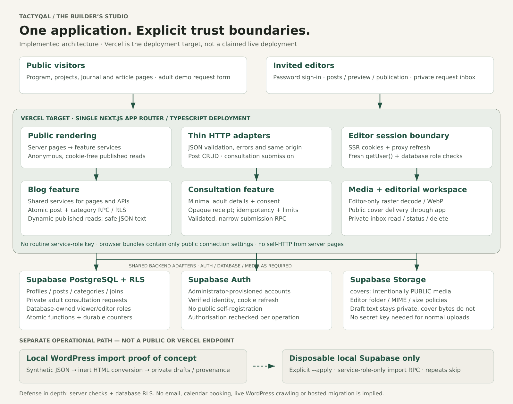

# Tactyqal — The Builder’s Studio

**A thoughtful mentoring-brand redesign, backed by a working editorial platform.**

Built for the **Tactyqal Labs Full Stack Developer Intern hiring challenge**. This independent submission combines a responsive public website, database-backed publishing, a protected editor workspace, and private consultation requests in one maintainable application.

[Explore the architecture](#architecture) · [Run locally](#run-locally) · [Deploy to Vercel](docs/deployment/vercel.md) · [Review the API](docs/architecture/blog-api.md)

> **Demo status:** the implementation is verified locally. A hosted deployment and recorded walkthrough have not been verified or supplied in this repository yet. After deploying, add the confirmed live URL and walkthrough link here before submitting. Do not treat a local Preview or a successful build as proof of hosted functionality.
>
> **Source code:** [github.com/ijatinydv/tactyqal](https://github.com/ijatinydv/tactyqal). Editor credentials must be shared privately, never committed or published in this README.

## The brief, addressed

| Challenge | Delivered |
|---|---|
| **Homepage redesign** | A responsive, editorial visual system with clear positioning, an eight-week program journey, practical parent information, FAQs, and original illustrative project stories |
| **Blog backend** | PostgreSQL schema, migrations, categories, protected CRUD APIs, draft/published lifecycle, safe structured content, and real cover storage |
| **Demonstrate the backend** | An invited-editor workspace for saving, previewing, publishing, updating, unpublishing, and deleting content; a live public Journal with search, categories, and pagination |
| **Submission evidence** | Complete source, reproducible local setup, database/browser tests, documented architecture and deployment instructions; hosted URL/walkthrough to be added after verification |

The brief describes the existing main site as CodeIgniter and its blog as WordPress. This is a standalone redesign/proof of concept, not a claim that either production system has been replaced or migrated.

## Product direction

**The Builder’s Studio** uses warm paper tones, forest-green actions, editorial typography, and deliberate whitespace instead of a generic AI/SaaS template. The experience speaks to young builders while giving parents concrete information about the mentoring process and next steps.

Project illustrations are original concept studies, **not student achievements**. Sample articles are explicitly identified as demo content. No invented mentor biographies, testimonials, fees, admissions promises, revenue claims, or scarcity counters are used. Research and content provenance are documented in the [brand and UX audit](docs/research/brand-ux-audit.md).

## What works

### Public website

- Responsive homepage and project index/detail pages with transparent concept provenance.
- Database-backed Journal, shareable search/category/page URLs, readable article pages, metadata, and a generated public sitemap.
- Homepage resources update after publication without a deployment.
- Minimal adult consultation form with explicit data-use acknowledgement and honest success/error states.

### Editorial workspace

- Administrator-provisioned password sign-in, verified identity, database-owned roles, and guarded server operations.
- Persisted drafts, saved private previews, categories, cover images/alt text, publishing, editing, unpublishing, and deletion.
- Structured blocks rather than arbitrary HTML. Untouched rich-text formatting is preserved; editing a formatted block warns before flattening it to plain text.
- Failed saves preserve input. Unsaved navigation requires confirmation; no fake autosave indicator.
- Private request inbox with status filtering, review/close transitions, and confirmed deletion.

### Backend and safety

- Atomic post/category writes and RLS-enforced draft/contact privacy.
- Same-origin checks, bounded bodies and pagination, field validation, and consistent JSON errors.
- Raster signature checks, full image decoding, pixel/size bounds, and metadata-stripping WebP conversion before storage.
- Opaque consultation receipts, idempotent retries, and durable database limits: three accepted requests per email/hour and thirty globally/hour.
- No service-role credential in normal application requests or browser bundles.

### Migration demonstration

The **local-only WordPress importer** defaults to a dry run. Explicit apply imports synthetic REST-shaped records as private drafts, retaining source URL, publication date, author attribution, slug, and categories. Repeated imports skip existing source identities without overwriting editorial changes; occupied manual slugs are reported as conflicts. HTML is converted through an inert allowlist, and each post/category operation is atomic.

This does not crawl a live archive, download source media, recreate arbitrary WordPress layouts, or activate redirects. [Read the import design](docs/architecture/wordpress-import.md).

## Blog migration

The repository includes a live, idempotent migration script to import all published posts from the company's real WordPress blog (`https://www.tactyqal.com/blog`) directly into the Supabase database.

### What the script does
- **API pagination:** Fetches all published posts via the WordPress REST API (`per_page=50`, `_embed=1`), paginating through all available pages until the entire archive is retrieved.
- **Resilient endpoints:** Queries the primary endpoint (`https://www.tactyqal.com/blog/wp-json/wp/v2/posts`) with automatic failover to the fallback route (`https://www.tactyqal.com/blog/?rest_route=/wp/v2/posts`) if the primary endpoint is blocked, rate-limited, or returns non-JSON responses.
- **Rich content mapping:** Converts raw WordPress HTML into the structured `RichDocument` AST consumed by `ArticleContent`. Accurately preserves headings (H2/H3), paragraphs, bullet lists, ordered lists, blockquotes, and inline formatting (bold, italic, and safe links). Strips WordPress shortcodes, script tags, iframes, and unwanted styling.
- **HTML entity decoding:** Cleans entities (e.g., `&#8217;`, `&amp;`, `&#8220;`, `&#8221;`, `&#8230;`) across titles, excerpts, and content bodies.
- **Field & taxonomy preservation:** Preserves original slugs, UTC publication timestamps (`published_at`), category taxonomies (upserted to `categories` and linked via `post_categories`), author attributions, and featured image cover URLs (`_embedded['wp:featuredmedia']`).
- **Immediate publication:** Imported articles are assigned `status: 'published'` with valid `published_at` timestamps, making them immediately visible on the public `/blog` and homepage.
- **Strict idempotency:** Re-running the script updates existing records matched by source identity (`imported_source_provider` + `imported_source_id`) or `slug`, never producing duplicate records or unique constraint violations.

### Running the import
```bash
# Run full live WordPress migration
pnpm import:wp

# Or with npm
npm run import:wp

# Optional test flags:
pnpm import:wp --limit 10   # Import a subset of posts
pnpm import:wp --dry-run    # Preview post parsing without DB writes
```

### Environment variables
The script reads from your environment or `.env` file:
- `NEXT_PUBLIC_SUPABASE_URL`: The URL of your Supabase project (e.g. `https://<ref>.supabase.co`).
- `SUPABASE_SERVICE_ROLE_KEY`: Service role administrative key required to bypass RLS for administrative batch ingestion.

### SEO & URL preservation
The migration preserves exact WordPress article slugs (e.g. `/blog/<slug>`). This guarantees:
1. **Zero ranking loss:** 301 redirects from the old WordPress site map 1:1 to identical `/blog/<slug>` paths on the Next.js site.
2. **Canonical and structured data:** Open Graph `publishedTime`, canonical URLs, and `Article` Schema.org JSON-LD match original publication dates, featured images, and excerpts.

## Architecture



[Open full-size diagram](docs/assets/architecture.png) · [Editable SVG source](docs/assets/architecture.svg) · [Detailed repository boundaries](docs/architecture/repository-structure.md)

### Why this structure

**One modular monolith, not unnecessary services.** Next.js owns rendering, routes, and the editor interface; domain logic lives in feature modules. A single application keeps deployment straightforward while allowing blog, authentication, and consultations to evolve independently.

**Thin routes, reusable services.** Public server pages and Route Handlers call the same domain services. Server pages do not make HTTP requests to their own API. SQL mutations that must be atomic are implemented as narrow database functions rather than multiple independent browser writes.

**Two permission boundaries.** Server code verifies the current Auth user and database-owned role. Supabase RLS independently protects rows. Public blog reads use a separate anonymous, cookie-free client and expose only currently published content. Proxy cookie refresh is not treated as authorisation.

**Private requests, explicit public media.** Contacts and drafts are private. Cover bytes are intentionally public even when an article is a draft; the upload UI says so. Consultation submission uses one validated database capability, not unrestricted anonymous table insertion. Operational import privileges are separate from deployed request handling.

**Honest freshness and scale.** Published reads are dynamic/no-store, mutation paths are invalidated, list requests are bounded, and SQL indexes support key queries. This favours correctness for the challenge's workload without claiming a load-tested enterprise architecture or introducing speculative microservices.

### Technology

| Layer | Choice |
|---|---|
| Application | Next.js 16.4.5 App Router, React 19.3.1, TypeScript 6.0.3 |
| Interface | Tailwind CSS 4.3.5, customised Radix-based primitives, locally bundled Newsreader/Manrope |
| Data and identity | Supabase PostgreSQL 17, Auth, Storage, generated database types |
| Validation and media | Zod, Sharp raster decoding/re-encoding |
| Verification | Vitest, Testing Library, Playwright, Axe Core, pgTAP, persisted HTTP/import tests |
| Deployment target | Vercel for Next.js; dedicated hosted Supabase for database/Auth/Storage |
| Package tooling | pnpm 10.34.9 with a committed lockfile; tested on Node 24 |

### Repository map

```text
src/
├── app/                 Public/auth/admin routes and thin API adapters
├── features/            Blog, auth, consultations, marketing, projects and media
├── components/          Shared UI primitives and layout
├── content/             Typed program and original project concepts
├── lib/                 Supabase clients, HTTP contracts and environment validation
└── types/               Generated database schema types
supabase/
├── migrations/          Schema, constraints, functions, policies and indexes
├── tests/               Rolled-back database permission/integrity assertions
└── seed.sql             Original synthetic categories/articles; no passwords
scripts/                 Local setup, test fixtures and import operations
tests/                   Browser journeys, persisted integration tests and fixtures
docs/                    Research, architecture, design, deployment and evidence
```

## Evaluate the submission

Use a dedicated **synthetic-data demo**. Judge access should be privately provisioned and revoked after evaluation.

1. Review the homepage and both project stories on desktop and mobile.
2. Open the Journal; type a query, filter a category, and open an article.
3. Sign in with a privately supplied editor account.
4. Create a post, save a draft, refresh, and open its saved preview. An incognito visitor must not see it.
5. Upload a small cover, add alternative text, publish, and verify the public article and homepage.
6. Edit, unpublish, and delete the post; confirm public visibility changes.
7. Send a synthetic adult request at `/contact`; review, change status, and delete it in `/admin/inquiries`.
8. Run the local import fixture twice to observe `inserted` then `skipped` and inspect retained provenance in protected preview.

**A consultation receipt is not an appointment or email.** The demo does not contact the real Tactyqal team. Do not enter children’s personal information or real customer details.

## Run locally

### Requirements

- Node **22–24**; Node 24 is the verified environment.
- pnpm **10.34.9**.
- A working Docker daemon and **Supabase CLI 3.0.0** for the local stack.
- Installed Chrome or an authorised Playwright browser for browser tests.

From a fresh checkout:

```bash
pnpm install --frozen-lockfile
pnpm db:start
pnpm env:local
pnpm editor:local
pnpm dev
```

`db:start` starts local Supabase, excluding its privileged vector log shipper. On first startup it applies migrations and the synthetic seed; on an existing local database, use `pnpm db:migrate` for pending migrations. `env:local` creates an ignored `.env.local` with only local public connection values and refuses to overwrite existing configuration.

`editor:local` generates a disposable confirmed editor and stores its credentials in ignored `.hoplite/runtime/local-editor.json` with private file permissions. It never prints the password and refuses hosted provisioning. Read this file only in your trusted local workspace—do not upload or commit it.

Open `http://localhost:3000`. If development HMR is unreliable in the sandbox, use the verified production path instead:

```bash
pnpm build
pnpm start
```

Do not run dev and production servers on the same port simultaneously. `pnpm db:reset` is **destructive local development tooling**, not a deployment command. No hosted reset is needed.

### Environment variables

```dotenv
NEXT_PUBLIC_SUPABASE_URL=https://YOUR_PROJECT_REF.supabase.co
NEXT_PUBLIC_SUPABASE_PUBLISHABLE_KEY=YOUR_PUBLISHABLE_KEY
NEXT_PUBLIC_SITE_URL=https://YOUR_PROJECT.vercel.app
```

For local development, `pnpm env:local` supplies local equivalents. `.env.example` contains names/placeholders only. The site URL must match the intended hosted canonical origin. Browser-safe keys do not replace RLS; never put service-role keys, database passwords, or access tokens in `NEXT_PUBLIC_*` variables.

## Deploy to Vercel

**Follow the [complete deployment runbook](docs/deployment/vercel.md)**—especially the hosted bucket, editor, and final smoke-test steps.

1. Create a dedicated hosted Supabase demo and apply all migrations with the **remote** CLI target.
2. Create the public `covers` bucket with raster MIME and size restrictions; local `config.toml` bucket creation does not deploy it.
3. Disable hosted public signup, create a confirmed password user, and bootstrap its editor role from trusted SQL.
4. Import this GitHub repository into Vercel as **Next.js**, root `./`, Node **24.x**, install `pnpm install --frozen-lockfile`, build `pnpm build`, default output directory.
5. Set the three environment variables above. Once the Vercel domain is known, update the site origin and **redeploy**. Align the hosted Auth Site URL.
6. Run the hosted smoke tests before sharing the URL or marking the submission deployed.

**Hosted upload caveat:** the current server-upload flow is subject to Vercel’s **4.5 MB function payload limit**, below the local 5 MiB allowance. Use cover files **under 2 MB** for the hosted demo. Direct-to-Storage upload is not implemented; do not claim the full local upload allowance on Vercel.

## Verification evidence

The recorded results below are from the implementation/release checks against **local Supabase and the production-mode application**, not hosted CI or a deployed Vercel environment.

| Command | Confirmed result |
|---|---|
| `pnpm check` | Lint, strict TypeScript, **17** unit/component tests passed |
| `pnpm db:test` | **131** database permission/integrity assertions passed |
| `pnpm test:import` | **4** importer tests passed with persistence enabled; none skipped |
| `pnpm test:integration` | Real persisted HTTP CRUD passed |
| `pnpm test:e2e` | **20** browser tests passed |
| `pnpm build` | Production build passed |

Tests cover draft privacy, authorisation, atomic writes, uploads, full publication lifecycle, consultation persistence/limits, failed-save recovery, search/pagination, sessions, and importer idempotency/rollback. The pgTAP runner uses the existing local Postgres container plus Perl `prove`, avoiding an unsupported helper-container security override.

For browser tests, use an installed browser and an already running production app:

```bash
CHROME_EXECUTABLE_PATH=/path/to/chrome \
PLAYWRIGHT_BASE_URL=http://127.0.0.1:3000 \
pnpm test:e2e
```

Axe scans cover 12 sampled routes, plus mobile-menu and 200% text-reflow checks. **This is not WCAG certification.** A recorded local performance sample and its conditions are in the [release evidence](docs/delivery/chunk-12.md); it is not a hosted Lighthouse or field-performance claim. GitHub CI was not configured as part of these checks.

## Trade-offs and remaining boundaries

- This is an independent prototype, not an official brand launch. Content rights, commercial terms, mentor details and eligibility need business confirmation.
- Public pages remain intentionally `noindex`. Hosted deployment and the walkthrough are not claimed until verified.
- Login is administrator-provisioned password access, not public signup, email invitation acceptance or password recovery.
- Request records remain until editor deletion or an explicit demo reset; no automatic retention service is invented. The small-demo rate limits require review before genuine public use.
- Covers are public, and removing a reference does not promise automatic orphan-file cleanup. There is no scheduling, revision history, public comments, LMS, payment service or AI chatbot.
- Slug changes remove the old address; the import retains original URLs but does not activate a production redirect map or migrate source media.

## Further documentation

- [Product brief and user journeys](docs/product/product-brief.md)
- [Brand research and UX audit](docs/research/brand-ux-audit.md)
- [Design specification](docs/design/design-specification.md)
- [Repository architecture](docs/architecture/repository-structure.md)
- [Database and role provisioning](docs/architecture/database.md)
- [Authentication boundaries](docs/architecture/authentication.md)
- [Blog API contract](docs/architecture/blog-api.md)
- [Consultation privacy/idempotency/limits](docs/architecture/consultations.md)
- [WordPress import design](docs/architecture/wordpress-import.md)
- [Delivery status and verification history](docs/delivery/status.md)
