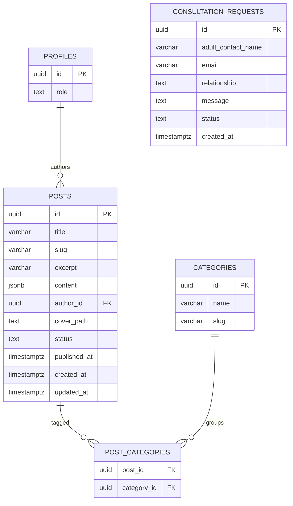
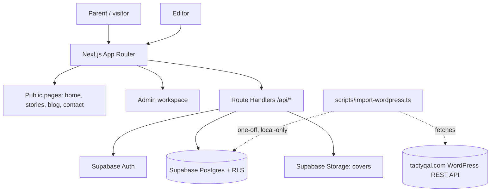

# Tactyqal Labs — Your teen’s idea, a launched app in 8 weeks

**A homepage redesign for Tactyqal Labs, backed by a working editorial platform.**

Built for the **Tactyqal Labs Full Stack Developer Intern hiring challenge**. This submission redesigns the real Tactyqal Labs homepage around the company's actual program, student apps, pricing, and testimonials — structured for its real buyer, a parent evaluating a mentoring program for their teen — and backs it with a database-driven blog, a protected editor workspace, and a consultation-request pipeline.

[Explore the architecture](#architecture) · [Run locally](#run-locally) · [Deploy to Vercel](docs/deployment/vercel.md) · [Review the API](docs/architecture/blog-api.md) · [API docs](/docs)

> **Live URL:** _add the confirmed deployment URL here after redeploying with real environment variables._
>
> **Source code:** [github.com/ijatinydv/tactyqal](https://github.com/ijatinydv/tactyqal).

## The 30-second pitch

Tactyqal Labs' original homepage had the content needed to sell the program — real student apps, real pricing, real testimonials — but it was buried under disclaimers, scattered across a disjointed blog, and never structured around how a parent actually decides: *what is it → proof it works → how it works → price → risk → next step.* This redesign keeps every real fact the company gave us, puts it in that order, and pairs it with a working CMS so the team can publish without a developer.

## The brief, addressed

| Challenge | Delivered |
|---|---|
| **Homepage redesign** | A parent-first structure (hero → stories → program → why us → tools → testimonials → journal → pricing → FAQ → contact), real student apps, real pricing, real testimonials, no invented claims |
| **Blog backend** | PostgreSQL schema, migrations, categories, protected CRUD APIs, draft/published lifecycle, safe structured content, real cover storage |
| **Demonstrate the backend** | An editor workspace for saving, previewing, publishing, updating, unpublishing, and deleting content; a live public Journal with search, categories, and pagination; `/docs` listing the real API surface |
| **Submission evidence** | Complete source, reproducible local setup, automated tests, documented architecture and deployment instructions |

## Product direction

The visual system keeps the calm, editorial look of the previous build — warm paper tones, forest-green actions, editorial typography, deliberate whitespace — but now carries real content with a confident, sales-oriented structure instead of a sketch-and-disclaimer pattern. Every claim on the homepage (student apps, stats, pricing, testimonials, FAQ) is sourced directly from the client; nothing is invented. Where the client's own material was ambiguous or very strong, the conservative version is used and the discrepancy is logged in [Content notes for the client](#content-notes-for-the-client) rather than disclaimed on the page itself.

**Screenshots:** _add homepage/mobile/admin screenshots here before submitting (see `docs/assets/`)._

## What works

### Public website

- Parent-first homepage: hero → student apps → 8-week program → why Tactyqal Labs → free tools → testimonials → Journal preview → pricing → FAQ → contact.
- A real student-apps gallery (`/projects`) and case-study pages, replacing the earlier placeholder concept pages.
- Database-backed Journal, shareable search/category/page URLs, readable article pages, metadata, and a generated public sitemap.
- Homepage resources (latest posts, pricing, FAQ) update after publication without a redeploy.
- A working consultation form with validation, a honeypot field, and clear success/error states.

### Editorial workspace

- Administrator-provisioned password sign-in, verified identity, database-owned roles, and guarded server operations.
- Persisted drafts, saved private previews, categories, cover images/alt text, publishing, editing, unpublishing, and deletion.
- Structured blocks rather than arbitrary HTML. Untouched rich-text formatting is preserved; editing a formatted block warns before flattening it to plain text.
- Failed saves preserve input. Unsaved navigation requires confirmation; no fake autosave indicator.
- Private request inbox with status filtering, review/close transitions, and confirmed deletion.

### Backend and safety

- Atomic post/category writes and RLS-enforced draft/contact privacy.
- Same-origin checks, bounded bodies and pagination, field validation, and consistent JSON errors.
- Raster signature checks, full image decoding, pixel/size bounds, and metadata-stripping WebP conversion before storage.
- Opaque consultation receipts, idempotent retries, and durable database limits: three accepted requests per email/hour and thirty globally/hour.
- No service-role credential in normal application requests or browser bundles.

### Migration demonstration

The **local-only WordPress importer** defaults to a dry run. Explicit apply imports REST-shaped records as private drafts, retaining source URL, publication date, author attribution, slug, and categories. Repeated imports skip existing source identities without overwriting editorial changes; occupied manual slugs are reported as conflicts. HTML is converted through an inert allowlist, and each post/category operation is atomic.

This does not crawl a live archive, download source media, recreate arbitrary WordPress layouts, or activate redirects. [Read the import design](docs/architecture/wordpress-import.md).

## Blog migration

The repository includes a live, idempotent migration script to import all published posts from the company's real WordPress blog (`https://www.tactyqal.com/blog`) directly into the Supabase database.

### What the script does
- **API pagination:** Fetches all published posts via the WordPress REST API (`per_page=50`, `_embed=1`), paginating through all available pages until the entire archive is retrieved.
- **Resilient endpoints:** Queries the primary endpoint (`https://www.tactyqal.com/blog/wp-json/wp/v2/posts`) with automatic failover to the fallback route (`https://www.tactyqal.com/blog/?rest_route=/wp/v2/posts`) if the primary endpoint is blocked, rate-limited, or returns non-JSON responses.
- **Rich content mapping:** Converts raw WordPress HTML into the structured `RichDocument` AST consumed by `ArticleContent`. Accurately preserves headings (H2/H3), paragraphs, bullet lists, ordered lists, blockquotes, and inline formatting (bold, italic, and safe links). Strips WordPress shortcodes, script tags, iframes, and unwanted styling.
- **HTML entity decoding:** Cleans entities (e.g., `&#8217;`, `&amp;`, `&#8220;`, `&#8221;`, `&#8230;`) across titles, excerpts, and content bodies.
- **Field & taxonomy preservation:** Preserves original slugs, UTC publication timestamps (`published_at`), category taxonomies (upserted to `categories` and linked via `post_categories`), author attributions, and featured image cover URLs (`_embedded['wp:featuredmedia']`).
- **Immediate publication:** Imported articles are assigned `status: 'published'` with valid `published_at` timestamps, making them immediately visible on the public `/blog` and homepage.
- **Strict idempotency:** Re-running the script updates existing records matched by source identity (`imported_source_provider` + `imported_source_id`) or `slug`, never producing duplicate records or unique constraint violations.

### Running the import
```bash
# Run full live WordPress migration
pnpm import:wp

# Or with npm
npm run import:wp

# Optional test flags:
pnpm import:wp --limit 10   # Import a subset of posts
pnpm import:wp --dry-run    # Preview post parsing without DB writes
```

### Environment variables
The script reads from your environment or `.env` file:
- `NEXT_PUBLIC_SUPABASE_URL`: The URL of your Supabase project (e.g. `https://<ref>.supabase.co`).
- `SUPABASE_SERVICE_ROLE_KEY`: Service role administrative key required to bypass RLS for administrative batch ingestion.

### SEO & URL preservation
The migration preserves exact WordPress article slugs (e.g. `/blog/<slug>`). This guarantees:
1. **Zero ranking loss:** 301 redirects from the old WordPress site map 1:1 to identical `/blog/<slug>` paths on the Next.js site.
2. **Canonical and structured data:** Open Graph `publishedTime`, canonical URLs, and `Article` Schema.org JSON-LD match original publication dates, featured images, and excerpts.

## Architecture


[Open full-size diagram](docs/assets/architecture.png) · [Editable SVG source](docs/assets/architecture.svg) · [Detailed repository boundaries](docs/architecture/repository-structure.md)

### Why this structure

**One modular monolith, not unnecessary services.** Next.js owns rendering, routes, and the editor interface; domain logic lives in feature modules. A single application keeps deployment straightforward while allowing blog, authentication, and consultations to evolve independently.

**Thin routes, reusable services.** Public server pages and Route Handlers call the same domain services. Server pages do not make HTTP requests to their own API. SQL mutations that must be atomic are implemented as narrow database functions rather than multiple independent browser writes.

**Two permission boundaries.** Server code verifies the current Auth user and database-owned role. Supabase RLS independently protects rows. Public blog reads use a separate anonymous, cookie-free client and expose only currently published content. Proxy cookie refresh is not treated as authorisation.

**Private requests, explicit public media.** Contacts and drafts are private. Cover bytes are intentionally public even when an article is a draft; the upload UI says so. Consultation submission uses one validated database capability, not unrestricted anonymous table insertion. Operational import privileges are separate from deployed request handling.

**Honest freshness and scale.** Published reads are dynamic/no-store, mutation paths are invalidated, list requests are bounded, and SQL indexes support key queries. This favours correctness for the challenge's workload without claiming a load-tested enterprise architecture or introducing speculative microservices.

### Technology

| Layer | Choice |
|---|---|
| Application | Next.js 16.4.5 App Router, React 19.3.1, TypeScript 6.0.3 |
| Interface | Tailwind CSS 4.3.5, customised Radix-based primitives, locally bundled Newsreader/Manrope |
| Data and identity | Supabase PostgreSQL 17, Auth, Storage, generated database types |
| Validation and media | Zod, Sharp raster decoding/re-encoding |
| Verification | Vitest, Testing Library, Playwright, Axe Core, pgTAP, persisted HTTP/import tests |
| Deployment target | Vercel for Next.js; dedicated hosted Supabase for database/Auth/Storage |
| Package tooling | pnpm 10.34.9 with a committed lockfile; tested on Node 24 |

### Repository map

```text
src/
├── app/                 Public/auth/admin routes and thin API adapters
├── features/            Blog, auth, consultations, marketing, projects and media
├── components/          Shared UI primitives and layout
├── content/             Typed real program, student apps, pricing, FAQ and testimonial content
├── lib/                 Supabase clients, HTTP contracts and environment validation
└── types/               Generated database schema types
supabase/
├── migrations/          Schema, constraints, functions, policies and indexes
├── tests/               Rolled-back database permission/integrity assertions
└── seed.sql             Starter categories/articles; no passwords
scripts/                 Local setup, test fixtures and import operations
tests/                   Browser journeys, persisted integration tests and fixtures
docs/                    Research, architecture, design, deployment and evidence
```

## Evaluate the submission

1. Review the homepage and student-app case studies on desktop (1280px), tablet (768px) and mobile (360px).
2. Open the Journal; type a query, filter a category, and open an article.
3. Sign in with a privately supplied editor account (see [Demo account](#demo-account)).
4. Create a post, save a draft, refresh, and open its saved preview. An incognito visitor must not see it.
5. Upload a small cover, add alternative text, publish, and verify the public article and the homepage Journal preview.
6. Edit, unpublish, and delete the post; confirm public visibility changes.
7. Submit a consultation request at `/contact`; review, change status, and delete it in `/admin/inquiries`.
8. Run the local import fixture twice to observe `inserted` then `skipped` and inspect retained provenance in protected preview.
9. Open `/docs` and confirm the listed endpoints match what's implemented.

Use your own test contact details when submitting the consultation form during evaluation; do not enter a real customer's or child's personal information.

## Run locally

### Requirements

- Node **22–24**; Node 24 is the verified environment.
- pnpm **10.34.9**.
- A working Docker daemon and **Supabase CLI 3.0.0** for the local stack.
- Installed Chrome or an authorised Playwright browser for browser tests.

From a fresh checkout:

```bash
pnpm install --frozen-lockfile
pnpm db:start
pnpm env:local
pnpm editor:local
pnpm dev
```

`db:start` starts local Supabase, excluding its privileged vector log shipper. On first startup it applies migrations and the synthetic seed; on an existing local database, use `pnpm db:migrate` for pending migrations. `env:local` creates an ignored `.env.local` with only local public connection values and refuses to overwrite existing configuration.

`editor:local` generates a disposable confirmed editor and stores its credentials in ignored `.hoplite/runtime/local-editor.json` with private file permissions. It never prints the password and refuses hosted provisioning. Read this file only in your trusted local workspace—do not upload or commit it.

Open `http://localhost:3000`. If development HMR is unreliable in the sandbox, use the verified production path instead:

```bash
pnpm build
pnpm start
```

Do not run dev and production servers on the same port simultaneously. `pnpm db:reset` is **destructive local development tooling**, not a deployment command. No hosted reset is needed.

### Environment variables

| Variable | Required | Purpose |
|---|---|---|
| `NEXT_PUBLIC_SUPABASE_URL` | Yes | Supabase project URL |
| `NEXT_PUBLIC_SUPABASE_PUBLISHABLE_KEY` | Yes | Browser-safe Supabase key (RLS-governed) |
| `NEXT_PUBLIC_SITE_URL` | Yes | Canonical public origin, used for sitemap/OG/canonical URLs |
| `SUPABASE_SERVICE_ROLE_KEY` | Only for `import:wp` | Bypasses RLS for the one-off WordPress migration script. Never expose in the app runtime or `NEXT_PUBLIC_*` |
| `ALLOW_INDEXING` | No (default `false`) | Set to `true` to let search engines index the site; keeps the demo `noindex` otherwise |

```dotenv
NEXT_PUBLIC_SUPABASE_URL=https://YOUR_PROJECT_REF.supabase.co
NEXT_PUBLIC_SUPABASE_PUBLISHABLE_KEY=YOUR_PUBLISHABLE_KEY
NEXT_PUBLIC_SITE_URL=https://YOUR_PROJECT.vercel.app
ALLOW_INDEXING=false
```

For local development, `pnpm env:local` supplies local equivalents. `.env.example` contains names/placeholders only. The site URL must match the intended hosted canonical origin. Browser-safe keys do not replace RLS; never put service-role keys, database passwords, or access tokens in `NEXT_PUBLIC_*` variables.

## Deploy to Vercel

**Follow the [complete deployment runbook](docs/deployment/vercel.md)**—especially the hosted bucket, editor, and final smoke-test steps.

1. Create a dedicated hosted Supabase demo and apply all migrations with the **remote** CLI target.
2. Create the public `covers` bucket with raster MIME and size restrictions; local `config.toml` bucket creation does not deploy it.
3. Disable hosted public signup, create a confirmed password user, and bootstrap its editor role from trusted SQL.
4. Import this GitHub repository into Vercel as **Next.js**, root `./`, Node **24.x**, install `pnpm install --frozen-lockfile`, build `pnpm build`, default output directory.
5. Set the three environment variables above. Once the Vercel domain is known, update the site origin and **redeploy**. Align the hosted Auth Site URL.
6. Run the hosted smoke tests before sharing the URL or marking the submission deployed.

**Hosted upload caveat:** the current server-upload flow is subject to Vercel’s **4.5 MB function payload limit**, below the local 5 MiB allowance. Use cover files **under 2 MB** for the hosted demo. Direct-to-Storage upload is not implemented; do not claim the full local upload allowance on Vercel.

## Verification evidence

The recorded results below are from the implementation/release checks against **local Supabase and the production-mode application**, not hosted CI or a deployed Vercel environment.

| Command | Confirmed result |
|---|---|
| `pnpm check` | Lint, strict TypeScript, **17** unit/component tests passed |
| `pnpm db:test` | **131** database permission/integrity assertions passed |
| `pnpm test:import` | **4** importer tests passed with persistence enabled; none skipped |
| `pnpm test:integration` | Real persisted HTTP CRUD passed |
| `pnpm test:e2e` | **20** browser tests passed |
| `pnpm build` | Production build passed |

Tests cover draft privacy, authorisation, atomic writes, uploads, full publication lifecycle, consultation persistence/limits, failed-save recovery, search/pagination, sessions, and importer idempotency/rollback. The pgTAP runner uses the existing local Postgres container plus Perl `prove`, avoiding an unsupported helper-container security override.

For browser tests, use an installed browser and an already running production app:

```bash
CHROME_EXECUTABLE_PATH=/path/to/chrome \
PLAYWRIGHT_BASE_URL=http://127.0.0.1:3000 \
pnpm test:e2e
```

Axe scans cover 12 sampled routes, plus mobile-menu and 200% text-reflow checks. **This is not WCAG certification.** A recorded local performance sample and its conditions are in the [release evidence](docs/delivery/chunk-12.md); it is not a hosted Lighthouse or field-performance claim. GitHub CI was not configured as part of these checks.

## Trade-offs and remaining boundaries

- The site is `noindex` by default (`ALLOW_INDEXING=false`); set the env var to `true` once the client approves going live.
- Login is administrator-provisioned password access (Supabase Auth), not public signup, email invitation acceptance, or password recovery.
- No `/api/v1` versioned prefix, generated OpenAPI spec, or interactive Swagger/Scalar "Try it out" UI yet — `/docs` currently lists the real endpoints with curl examples instead (see [What I would do next](#what-i-would-do-next)).
- No seeded `SEED_EDITOR_EMAIL` / `SEED_EDITOR_PASSWORD` demo account or `seed:reset` script yet — editor accounts are provisioned via `pnpm editor:local` (local) or a trusted SQL bootstrap (hosted), consistent with Supabase Auth rather than a custom bcrypt/argon2 login.
- No GitHub Actions CI workflow yet; `pnpm check` and `pnpm build` are run manually before each change (see [Verification evidence](#verification-evidence)).
- Request records remain until editor deletion; no automatic retention service is invented. The small-demo rate limits require review before genuine public use.
- Covers are public, and removing a reference does not promise automatic orphan-file cleanup. There is no scheduling, revision history, public comments, LMS, payment service or AI chatbot.
- Slug changes remove the old address; the import retains original URLs but does not activate a production redirect map or migrate source media.

## Database schema



## Architecture diagram



## API

All responses share one envelope: `{ data }` on success, `{ error: { code, message, fields? } }` on failure. Admin routes require an authenticated editor session cookie and are rate-limited. The full, current list with curl examples is also rendered at **`/docs`** (linked from the footer).

| Method | Path | Auth | Description |
|---|---|---|---|
| GET | `/api/posts` | Public | List published posts (pagination, search, category) |
| GET | `/api/posts/:slug` | Public | Get a published post by slug |
| GET | `/api/categories` | Public | List categories |
| POST | `/api/consultations` | Public | Submit a consultation request (rate-limited, honeypot) |
| GET | `/api/admin/posts` | Editor | List all posts (draft + published), search/status filters |
| POST | `/api/admin/posts` | Editor | Create a post |
| PATCH | `/api/admin/posts/:id` | Editor | Update a post |
| DELETE | `/api/admin/posts/:id` | Editor | Soft-delete a post |
| GET | `/api/admin/categories` | Editor | List categories for the editor workspace |
| GET | `/api/admin/inquiries` | Editor | List consultation requests |
| PATCH | `/api/admin/inquiries/:id` | Editor | Update a request's status, or delete it |
| POST | `/api/admin/uploads` | Editor | Upload and validate a cover image |
| GET | `/api/health` | Public | Health check |

```bash
# Public: list the 3 latest published posts
curl "https://your-domain/api/posts?page=1&pageSize=3"

# Public: submit a consultation request
curl -X POST https://your-domain/api/consultations \
  -H "Content-Type: application/json" \
  -d '{"adult_contact_name":"Asha Rao","email":"asha@example.com","relationship":"parent_guardian","data_use_acknowledged":true}'

# Health check
curl https://your-domain/api/health
```

## Demo account

The editor workspace uses **Supabase Auth**, not a custom password table, so credentials aren't baked into application source or a seed script in this pass. To evaluate the editor workspace:

- **Locally:** run `pnpm editor:local` — it provisions a disposable confirmed editor and writes credentials only to the git-ignored `.hoplite/runtime/local-editor.json` (never printed to the terminal or committed).
- **Hosted:** create a confirmed Supabase Auth user and promote it to the `editor` role via the trusted SQL bootstrap described in [the deployment runbook](docs/deployment/vercel.md).

> The brief's requested demo pattern — `SEED_EDITOR_EMAIL` / `SEED_EDITOR_PASSWORD` env vars, argon2/bcrypt hashing, a public `test123@gmail.com` demo login, and `npm run seed:reset` — was **not** implemented in this pass because it doesn't map directly onto Supabase Auth's managed identity model. It's listed in [What I would do next](#what-i-would-do-next). **If a public demo login is published, rotate its password immediately after judging.**

## Problems found in the current site and how this redesign addresses them

| Problem in the live site | Fix in this redesign |
|---|---|
| Structure doesn't follow how a parent decides (what is it → proof → how it works → price → risk → next step) | Homepage rebuilt in exactly that order: hero → student stories → 8-week program → why Tactyqal Labs → free tools → testimonials → Journal → pricing → FAQ → contact |
| Stock/stand-in testimonial photos | Replaced with initials avatars; no stock photography |
| Conflicting or unclear stats (e.g. student counts) | Uses only the conservative, confirmed figures ("50+ students", "6 featured apps"); conflicts logged below instead of guessed |
| Heavy autoplay video on load | Hero video is click-to-play, `preload="none"`, no autoplay, respects `prefers-reduced-motion` |
| Blog felt disjointed from the main site and brand | Journal is a first-class section (homepage preview + `/blog`), same design system, same navigation |
| Free tools were buried / hard to find | Dedicated "Free tools" section with its own anchor (`#tools`) in primary navigation |
| Backend/CRUD not visible or provable | Editor workspace, documented REST API, and `/docs` page make the backend inspectable, not just claimed |

## Content notes for the client

These items need your confirmation before this goes live. Nothing below was invented — it's flagged because the source material was ambiguous, very strong, or needs a business decision:

- **"50+ students mentored"** — your materials have referenced numbers as high as 100+ elsewhere; we used the conservative "50+" for the hero stat. Please confirm the current, defensible figure.
- **University admission claims** — the FAQ says projects "strengthen university applications," not that admission is guaranteed. We deliberately **omitted** "What is the success rate?" and "What universities have your students gotten into?" from the public FAQ until you can confirm numbers/names that won't overstate outcomes (e.g. no Ivy League claim is made anywhere on the site).
- **"Results guaranteed or money back"** — included verbatim per your pricing copy. Please confirm the exact refund terms/conditions you want legally backing this before launch.
- **Pricing and spot scarcity** — INR 25,000 → INR 16,000 and "only 15 spots available for the month" are shown as given. Confirm these are currently accurate and how often they should be updated.
- **Free tools external link** (`https://www.tactyqal.com/#tools`) — confirm this is the correct, current destination for "Access all tools free."
- **Student revenue figures** (INR 9,000 first week; INR 100,000/month) and ages (16, 13) — used verbatim as supplied; confirm these are still current and that the students have consented to being named publicly.
- **Testimonial attribution** — the six testimonials are shown with first/last name and initials only (no photos, no app affiliation claimed). Confirm this is an acceptable level of attribution.

## Design decisions

- **No new animation library.** Scroll reveals use a small `IntersectionObserver`-based component (`Reveal`) instead of adding Framer Motion, to keep the bundle lean; it respects `prefers-reduced-motion` via the existing global CSS rule.
- **Kept `@fontsource` instead of switching to `next/font/google`.** The two fonts (Newsreader, Manrope) are already bundled locally with `font-display: swap`, which gets the same performance benefit without adding a build-time network dependency on Google's font CDN.
- **Native `<details>`/`<summary>` for FAQ and `<details>`-free ARIA tabs for the program timeline** instead of a new Radix Accordion/Tabs dependency — both are fully keyboard accessible out of the box.
- **Student app images are hot-linked from `tactyqal.com`** via `next/image` `remotePatterns` (already configured) rather than re-hosted, since these are the client's real screenshots; each card has an `onError` fallback in case an asset moves.

## What I would do next

- Generate `openapi.json` from the existing Zod schemas (e.g. `zod-to-openapi`) and serve interactive Swagger/Scalar docs with a working "Authorize" flow at `/docs`.
- Add `/api/v1` versioning, a seeded demo editor account driven by `SEED_EDITOR_EMAIL`/`SEED_EDITOR_PASSWORD`, and `npm run seed:reset`.
- Add a GitHub Actions workflow running `pnpm lint`, `pnpm typecheck`, `pnpm test`, and `pnpm build` on every PR.
- Run a hosted Lighthouse pass (mobile) and fix any gaps to each category's 95+ target; capture before/after scores here.
- Record a short walkthrough video and add the live Vercel URL to the top of this README.

## Further documentation

- [Product brief and user journeys](docs/product/product-brief.md)
- [Brand research and UX audit](docs/research/brand-ux-audit.md)
- [Design specification](docs/design/design-specification.md)
- [Repository architecture](docs/architecture/repository-structure.md)
- [Database and role provisioning](docs/architecture/database.md)
- [Authentication boundaries](docs/architecture/authentication.md)
- [Blog API contract](docs/architecture/blog-api.md)
- [Consultation privacy/idempotency/limits](docs/architecture/consultations.md)
- [WordPress import design](docs/architecture/wordpress-import.md)
- [Delivery status and verification history](docs/delivery/status.md)
